# Kepryx demo evidence pack

This directory is the presentation pack for the Kepryx v0.9.0 community preview. It is designed
for a technical audience: every story is tied to an executable route, fixture, test, or release
record, and every unproven production claim is called out.

The recommended resource-constrained setup is documented in
[LOCAL-LAB-PLAN.md](LOCAL-LAB-PLAN.md). It uses the dedicated `docker-compose.demo.yml` overlay,
one optional Linux VM, local response-shape fixtures, and an isolated scan network.

For real provider pulls, use [REAL-INTEGRATION-LAB.md](REAL-INTEGRATION-LAB.md). It adds FleetDM
for one enrolled endpoint and NetBox for network inventory, with explicit boundaries around what
each source does and does not prove.

## Product preview

These are actual operator-console captures from the local preview build using synthetic data. The
[public product gallery](../PUBLICATION/PRODUCT-GALLERY.md) indexes the captured product views
and workflow evidence, including the interactive relationship map, evidence lineage, authorized
scan configuration, Assistant, API tokens, webhooks, privacy, and administration.

| Dashboard | Kepryx Assistant | Compliance |
|---|---|---|
| 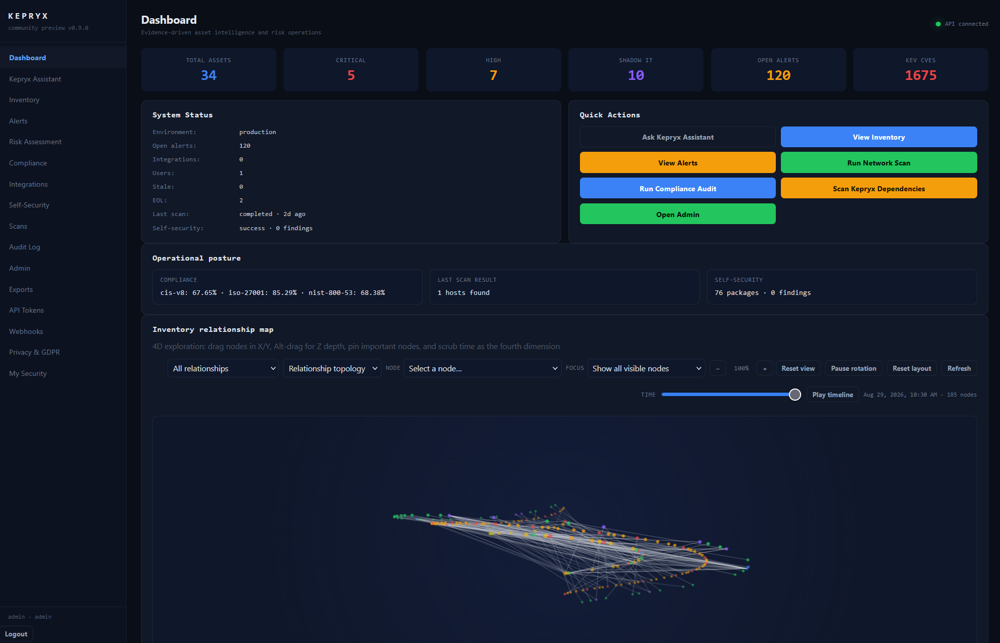 | 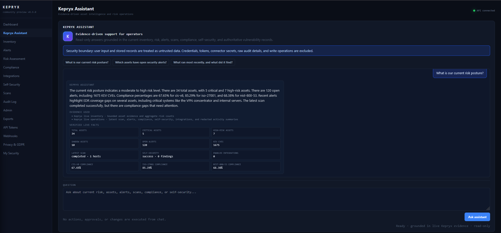 | 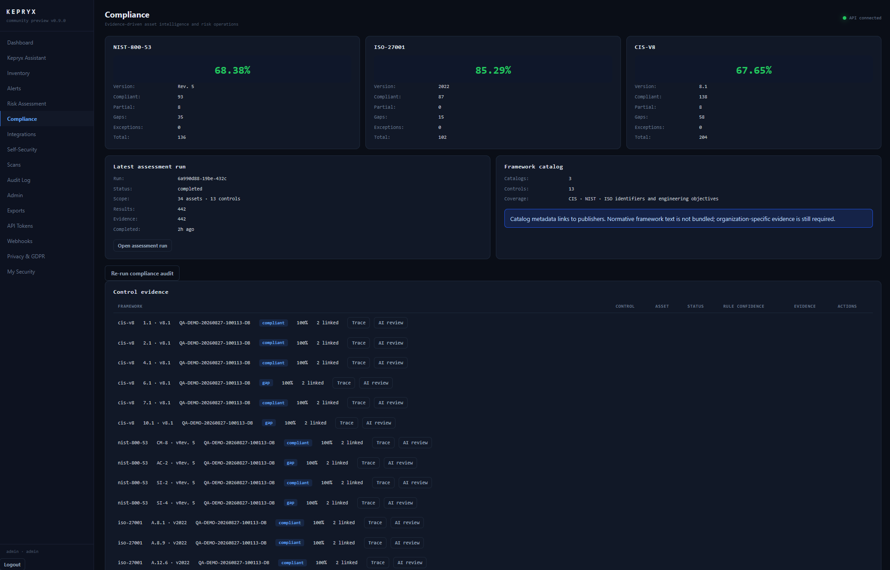 |

### Compliance evidence workflow

These two workflow captures make the compliance story concrete: the first traces a control result
back to the observed asset evidence, and the second shows the local AI review as advisory guidance.
Both use synthetic preview data; the AI review does not change Kepryx data.

| Evidence lineage | Advisory AI review |
|---|---|
| 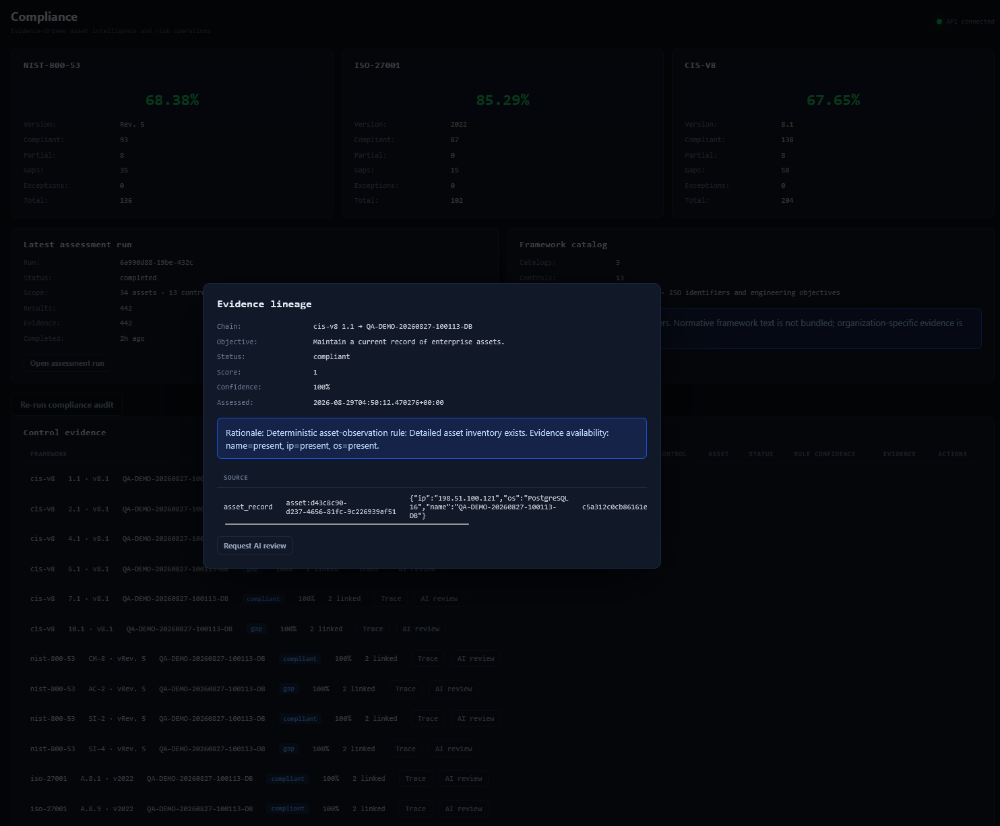 | 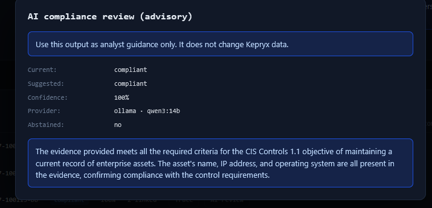 |

*The lineage screenshot uses a reserved documentation address (`198.51.100.121`). The AI review
shows the local Ollama/Qwen3 provider and is not an automated compliance decision.*

### Additional operator views

The complete gallery now includes the other synthetic operator-console screens used to explain
the v0.9.0 preview. These are screenshots from the same local build, not generated mockups.

| Alerts | Risk assessment | Self-security | Scans |
|---|---|---|---|
| 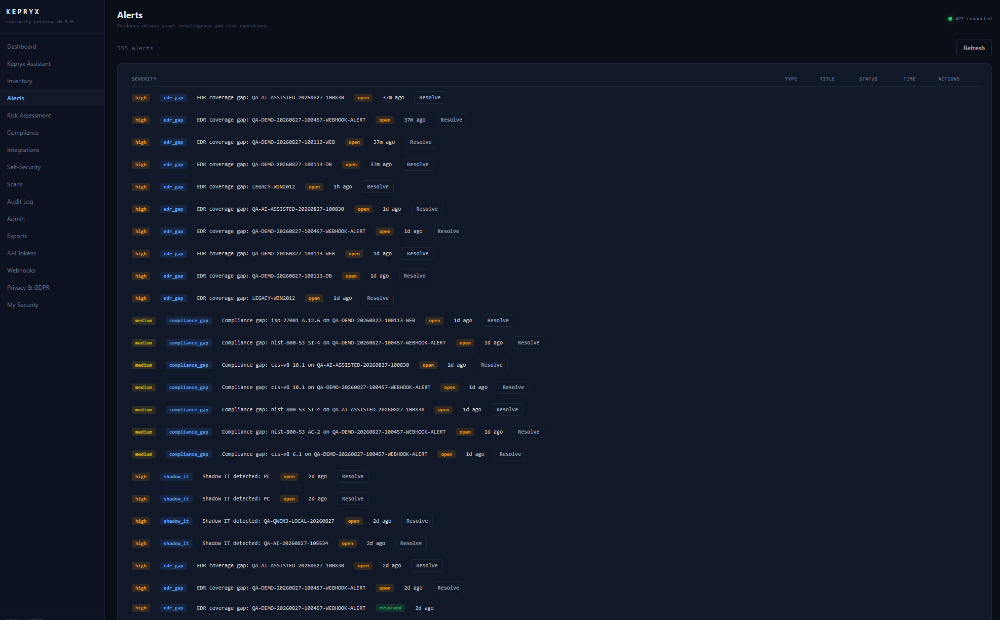 | 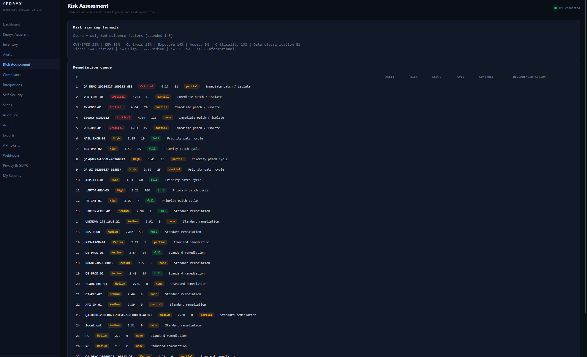 | 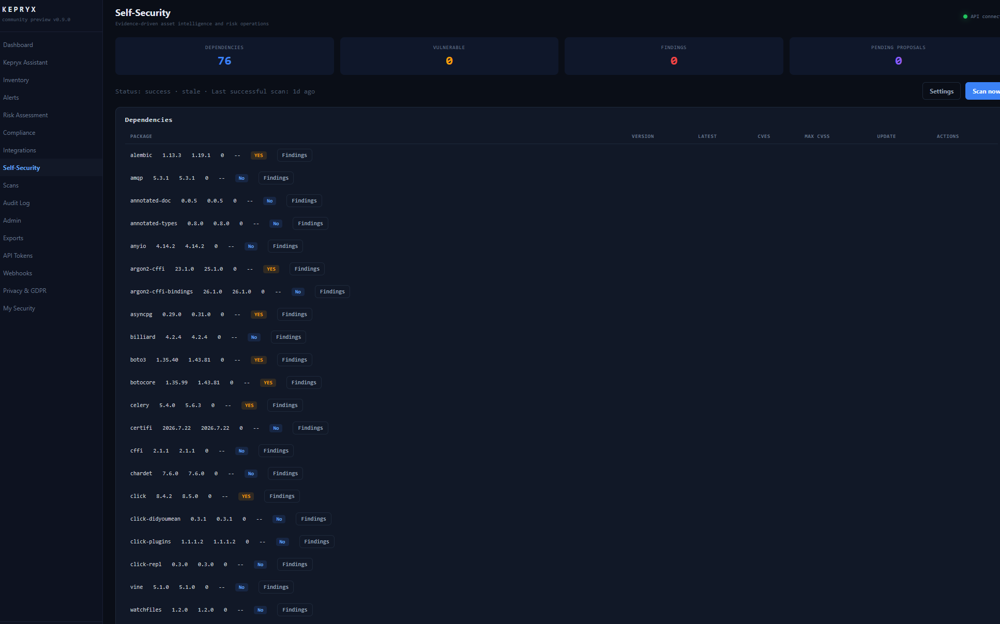 | 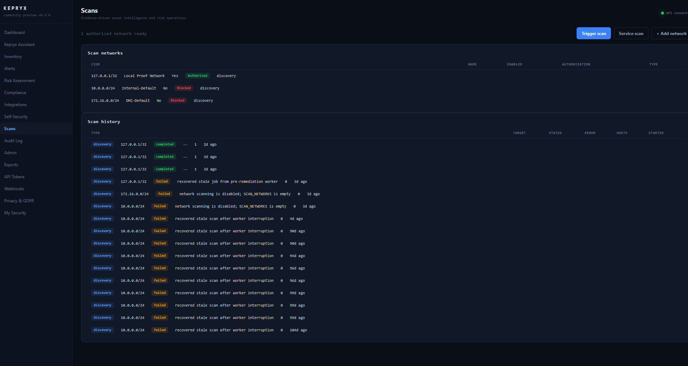 |

| Audit log | Administration | Exports | API tokens |
|---|---|---|---|
| 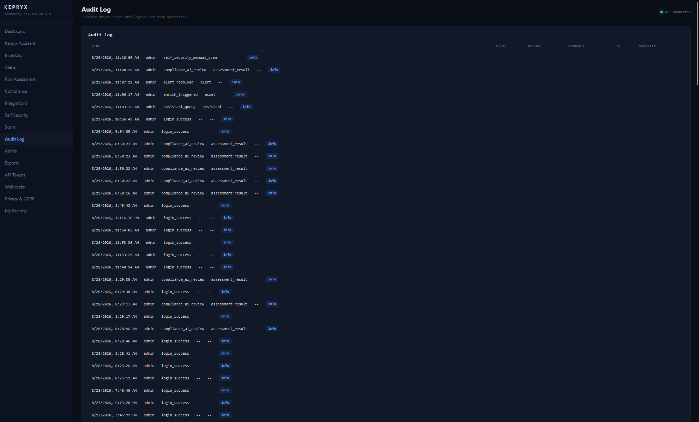 | 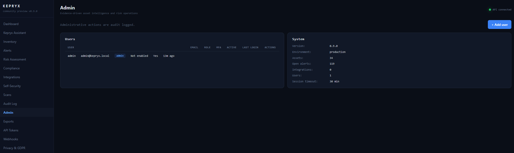 | 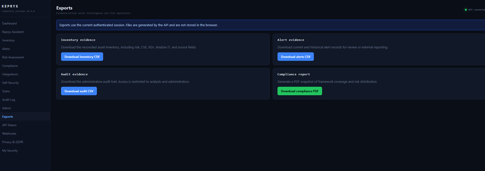 | 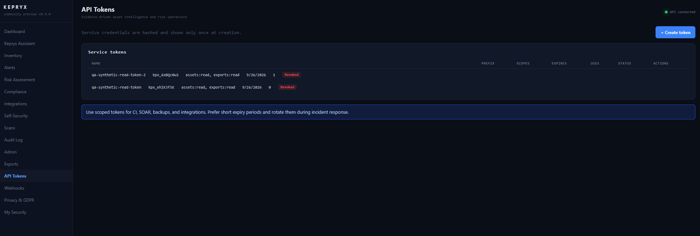 |

| Webhooks | Privacy and GDPR | My Security | Relationship map |
|---|---|---|---|
| 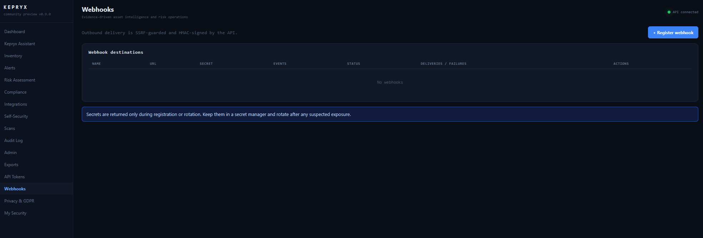 | 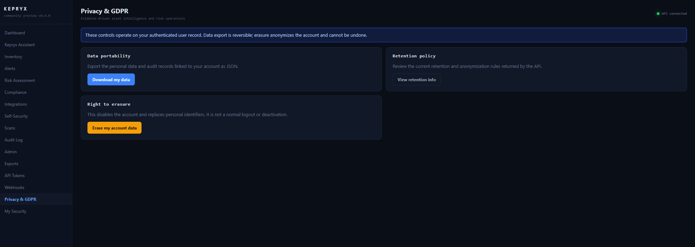 | 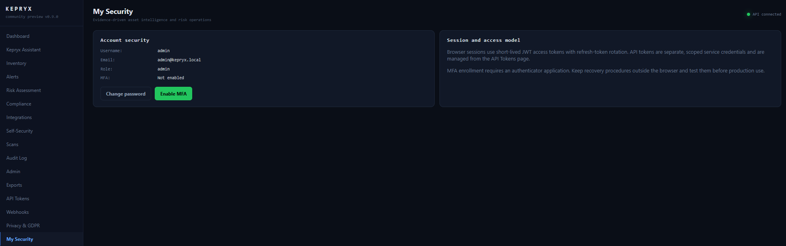 | 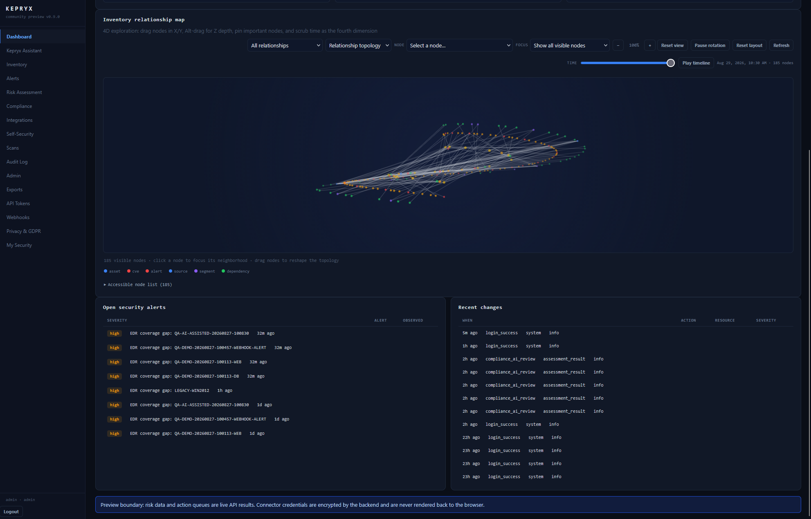 |

The Inventory page is intentionally not represented by the older captures because they show a
non-current fixture. A vendor-neutral inventory capture, login screen, and alert
investigation/resolution sequence still need to be recaptured before they are advertised as
complete workflows.

The screenshots are point-in-time preview evidence. They do not prove production scale, enterprise
SSO, high availability, certification, or a permanent CVE-free state.

## Use this pack

The canonical producer sequence is:

1. Start with [DEMO-PACK.md](DEMO-PACK.md) for the story, profile, claims boundary, and material
   order.
2. Run [DEMO-CHECKLIST.md](DEMO-CHECKLIST.md) before rehearsal and again before recording.
3. Use [DEMO-SCRIPT.md](DEMO-SCRIPT.md) for the timed walkthrough and speaker notes.
4. Use [DEMO-MATERIALS.md](DEMO-MATERIALS.md) as the shot list for screenshots and diagrams.
5. Use [DEMO-QA-AND-CLAIMS.md](DEMO-QA-AND-CLAIMS.md) during technical review and questions.
6. Use [EVIDENCE-MATRIX.md](EVIDENCE-MATRIX.md) to explain what is proven, how it is proven, and
   what remains outside the preview boundary.
7. Use [BENCHMARKS-AND-COMPARISON.md](BENCHMARKS-AND-COMPARISON.md) for measured local evidence
   and capability positioning.
8. Use [RECORDING-NOTES-TEMPLATE.md](RECORDING-NOTES-TEMPLATE.md) to retain the exact commit,
   profile, evidence, and deviations for the recording.
9. Use the public [product gallery](../PUBLICATION/PRODUCT-GALLERY.md) to select the product and
   workflow captures for the article or recording.

## Repeatable operator controls

Use the guarded stop scripts when switching between the synthetic demo and the real-provider lab;
both profiles use the same local demo ports:

```powershell
pwsh -NoProfile -File .\demo\Stop-Demo.ps1
pwsh -NoProfile -File .\demo\integrations\Stop-IntegrationLab.ps1
```

Add `-RemoveContainers` when containers and networks should be removed while keeping provider
volumes. Do not use a volume-removal command unless the disposable databases are intentionally
being erased.

After the synthetic demo is running, collect a redacted, commit-linked evidence manifest:

```powershell
pwsh -NoProfile -File .\demo\Collect-DemoEvidence.ps1
```

The generated `demo/evidence-manifest.local.json` is ignored by Git. It contains commit,
fixture, service, health/readiness, and timing metadata only; it does not read or export `.env`
values, API tokens, or connector secrets.

## Visual index

- [System context](../diagrams/kepryx-system-context.svg)
- [Ingest to risk flow](../diagrams/ingest-risk-flow.svg)
- [Compliance evidence lineage](../diagrams/compliance-evidence-lineage.svg)
- [Product gallery](../PUBLICATION/PRODUCT-GALLERY.md)
- [Release scorecard chart](../images/release-scorecard-chart.svg)

The technical diagrams use a consistent focus-box convention: the amber dashed square marks the
one engineering boundary or operator action the audience should understand in that frame. Product
screenshots are raw captures; the caption identifies the operator action to explain.

## Evidence rules

- The primary demo source is the vendor-neutral CSV fixture at
  `demo/data/assets-full.csv`.
- The software composition path uses `demo/data/software-inventory.csv`; it is a parent-solution
  inventory fixture and is evaluated against the local vulnerability snapshot.
- The optional Asset Source mock is synthetic, local-only, and not a provider certification or a
  native Wazuh/Elastic/Snort integration.
- The local vulnerability service mirrors the response shapes consumed by Kepryx and is explicitly
  a snapshot fixture; it does not claim current feed freshness.
- Reserved documentation ranges (`198.51.100.0/24` and `203.0.113.0/24`) are used for demo data;
  they are not authorization to scan any real network.
- Counts, timings, image findings, and test results in the pack are labeled with their evidence
  date and environment. Re-run the commands before a new release.
- Do not record or publish credentials, bearer tokens, private certificates, `.env` files, or raw
  customer data.

## Recording deliverables

Save the final recording outside the repository until it has been reviewed. Alongside it, retain
the tested commit, timestamp, environment/profile, and a redacted transcript or scene checklist.
Do not add disposable recordings, exports, screenshots containing secrets, or local certificates
to the public repository.
